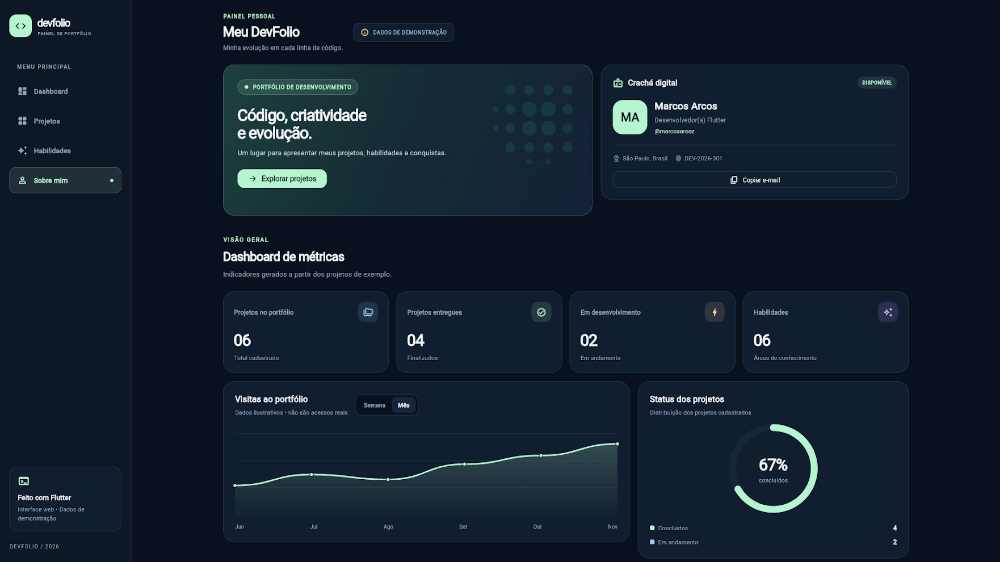
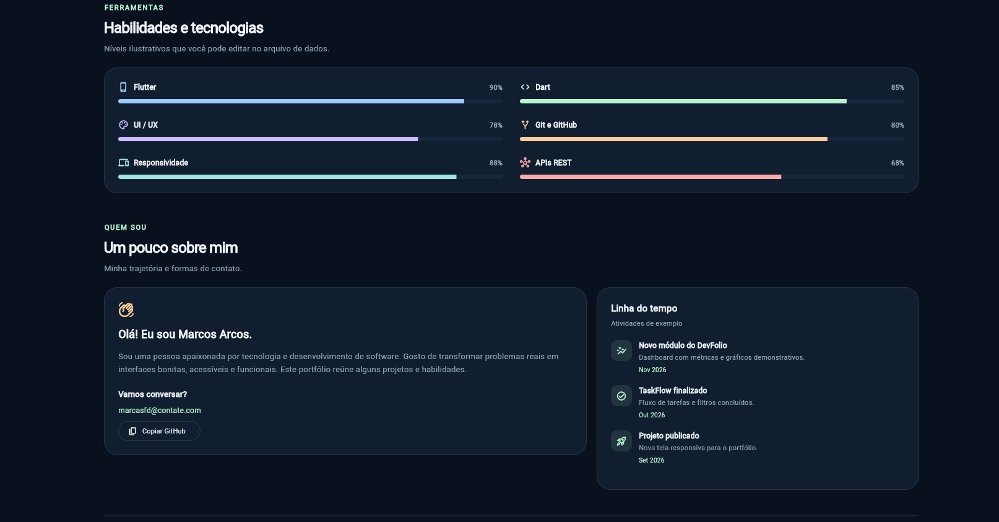

# DevFolio App — Flutter Web

> **PPDM • Projeto final • Demo Day: 17/11/2026**  
> Portfólio pessoal com **crachá digital**, **dashboard de métricas**, projetos, habilidades e linha do tempo.

O DevFolio foi criado em Flutter/Dart, com visual responsivo, componentes separados na pasta `lib/widgets/` e sem dependências de pacotes externos. Os exemplos de projetos e as visitas ao perfil são **demonstrativos**, para facilitar a personalização antes da apresentação.

## 1. Capturas de tela do aplicativo

Depois de rodar o aplicativo **no navegador/servidor da sala**, salve capturas verdadeiras em `docs/screenshots/` com estes nomes:

- `dashboard-desktop.png` — deve mostrar o **Perfil/Crachá** e o **Dashboard de Métricas** na porta 8080 ou 8081.
- `projetos.png` — demonstra os cards e o filtro por status.
- `dashboard-mobile.png` — layout responsivo (opcional, mas recomendado).

Quando colocar os arquivos, descomente as imagens abaixo para elas aparecerem no GitHub:

<!--



-->

**Importante:** prints reais não acompanham este pacote porque precisam ser produzidos com a aplicação executada. Não use mockups como prova de funcionamento. Veja [instruções de capturas](docs/screenshots/README.md).

## 2. Componentes desenvolvidos

| Arquivo | Função |
|---|---|
| `lib/main.dart` | Ponto de entrada da aplicação. |
| `lib/app.dart` | Estrutura principal, layout adaptativo e navegação com rolagem. |
| `lib/widgets/portfolio_navigation.dart` | Sidebar desktop e navegação horizontal mobile. |
| `lib/widgets/intro_banner.dart` | Destaque inicial com botão que abre a seção de projetos. |
| `lib/widgets/profile_badge.dart` | Crachá com nome, função, local, identificador e cópia de e-mail. |
| `lib/widgets/metric_dashboard.dart` | Dashboard e taxa de conclusão calculada dos projetos. |
| `lib/widgets/metric_card.dart` | Card reutilizável para indicadores. |
| `lib/widgets/visits_chart.dart` | Gráfico customizado em Dart; alternância semana/mês. |
| `lib/widgets/projects_section.dart` | Listagem com filtros: todos, concluídos e em andamento. |
| `lib/widgets/project_card.dart` | Card de projeto com tecnologias e status. |
| `lib/widgets/skills_section.dart` | Indicadores de habilidades editáveis. |
| `lib/widgets/about_section.dart` | Sobre mim, contato e linha do tempo. |
| `lib/widgets/surface_card.dart` | Estrutura visual reutilizável de card. |
| `lib/widgets/section_header.dart` | Cabeçalhos reutilizáveis das seções. |
| `lib/data/portfolio_data.dart` | Dados da pessoa, projetos, habilidades e visitas fictícias. |
| `lib/models/portfolio_project.dart` | Modelos e enum de status dos projetos. |
| `lib/theme/app_theme.dart` | Cores e tema visual global. |

## 3. Tecnologias

- **Flutter e Dart** — construção da aplicação web.
- **Material Design 3** — componentes visuais.
- **CustomPainter** — gráfico desenhado sem bibliotecas de terceiros.
- **Git e GitHub** — versionamento e documentação.
- **GitHub Actions** — rotina automatizada para análise, testes e build (quando publicada no repositório).

## 4. Como executar (Windows, Linux ou macOS)

### Pré-requisitos

1. Instale o [Flutter SDK](https://docs.flutter.dev/get-started/install) e habilite os comandos `flutter` e `dart` no terminal.
2. Tenha o Google Chrome ou outro navegador moderno para conferir o projeto.
3. Verifique o ambiente:

```bash
flutter doctor
flutter config --enable-web
flutter devices
```

### Início do projeto

Abra um terminal **na pasta `devfolio_app`** e execute:

```bash
flutter create --platforms=web .
flutter pub get
flutter run -d chrome
```

O comando `flutter create --platforms=web .` garante que os arquivos web exigidos pela versão instalada do Flutter estejam presentes; os arquivos Dart já criados devem ser preservados.

### Executar na porta 8080 (servidor da sala)

```bash
flutter run -d web-server --web-hostname 0.0.0.0 --web-port 8080
```

No próprio computador: `http://localhost:8080`. Se o servidor da sala usa outro endereço, acesse `http://IP-DO-SERVIDOR:8080`. Se a porta 8080 estiver ocupada:

```bash
flutter run -d web-server --web-hostname 0.0.0.0 --web-port 8081
```

**Observação:** a interface, a porta 8080 e os dados de demonstração estão preparados no código, mas o teste final no servidor da sua sala precisa ser realizado no seu ambiente.

### Criar versão de distribuição

```bash
flutter build web --release
```

Arquivos gerados: `build/web/`. Se desejar servir os arquivos compilados com Python:

```bash
python -m http.server 8080 --directory build/web
```

## 5. Personalização obrigatória antes de entregar

Abra **`lib/data/portfolio_data.dart`** e substitua os dados fictícios:

```dart
static const name = 'Seu Nome';
static const initials = 'SN';
static const username = '@seuusuario';
static const email = 'contato@exemplo.com';
static const github = 'github.com/seu-usuario';
```

Atualize também as listas `projects`, `skills`, `activities` e, caso queira mostrar estatísticas reais, conecte um serviço de analytics (as visitas atuais são ilustrativas). O total de projetos, os concluídos, os em andamento e o percentual de conclusão são **recalculados automaticamente** a partir do status da lista de projetos.

**Atenção à autoria:** os seis projetos descritos inicialmente são exemplos fictícios; substitua-os pelos trabalhos realmente desenvolvidos pela dupla. Se desejar, altere as datas e textos da linha do tempo para refletirem o histórico real.

## 6. Testar e validar

```bash
flutter analyze
flutter test
flutter build web --release
```

Há testes de consistência das métricas em `test/portfolio_data_test.dart` e um fluxo de CI em `.github/workflows/flutter-check.yml` para executar análise, testes e build após cada push.

Para demonstrar no Demo Day, abra o endereço do servidor e confira:

- o **crachá** exibindo o perfil cadastrado;
- os quatro indicadores do dashboard e o gráfico com filtro **Semana/Mês**;
- a rolagem do menu para as seções;
- os filtros **Todos / Concluídos / Em andamento**;
- a adaptação a diferentes larguras de tela;
- o botão de copiar o e-mail.

## 7. Publicar no GitHub

Crie no GitHub um repositório **público** chamado `devfolio_app`. Dentro da pasta do projeto:

```bash
git init
git add .
git commit -m "feat: cria DevFolio com cracha e dashboard"
git branch -M main
git remote add origin https://github.com/SEU-USUARIO/devfolio_app.git
git push -u origin main
```

Se você já iniciou o repositório, **não execute `git init` novamente**; use apenas `git add`, `git commit` e `git push` conforme o estado atual. Não publique dados privados ou senhas. Depois dos prints, faça novo commit:

```bash
git add README.md docs/screenshots/
git commit -m "docs: adiciona capturas da aplicacao em execucao"
git push
```

## 8. Entrega no Classroom

Até **17/11/2026 às 23h59**, envie:

1. Link público do repositório GitHub.
2. `lib/main.dart` e **todos** os `.dart` de `lib/widgets/` (se exigido, anexe os arquivos individualmente).
3. Print real da aplicação em execução no navegador/servidor da sala, mostrando o crachá e o dashboard, com porta **8080 ou 8081**.
4. README atualizado com as capturas, descrição dos componentes e dados da dupla.

O envio deve coincidir com a apresentação presencial de **17/11/2026**.

---

**Projeto didático:** interface pronta para personalização e testes locais. Nenhuma conexão real com analytics, backend ou GitHub está implícita.
